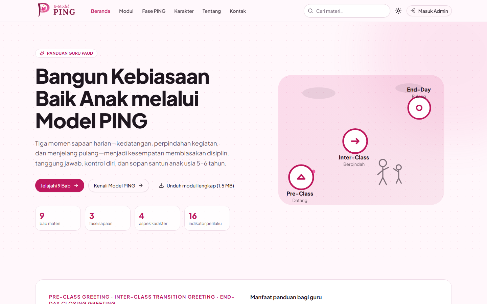
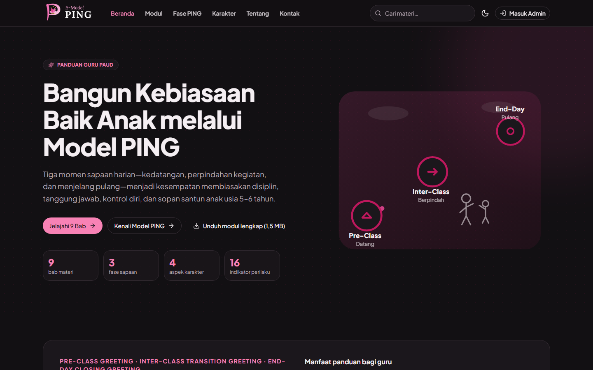
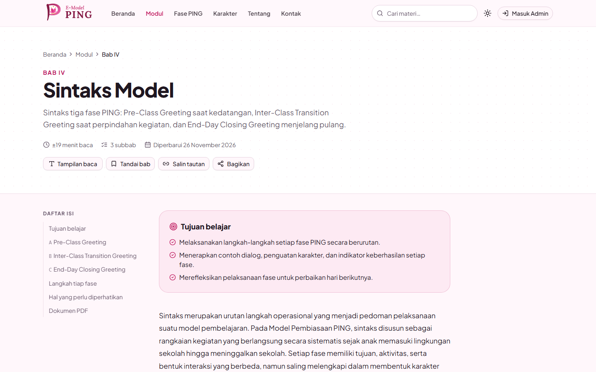
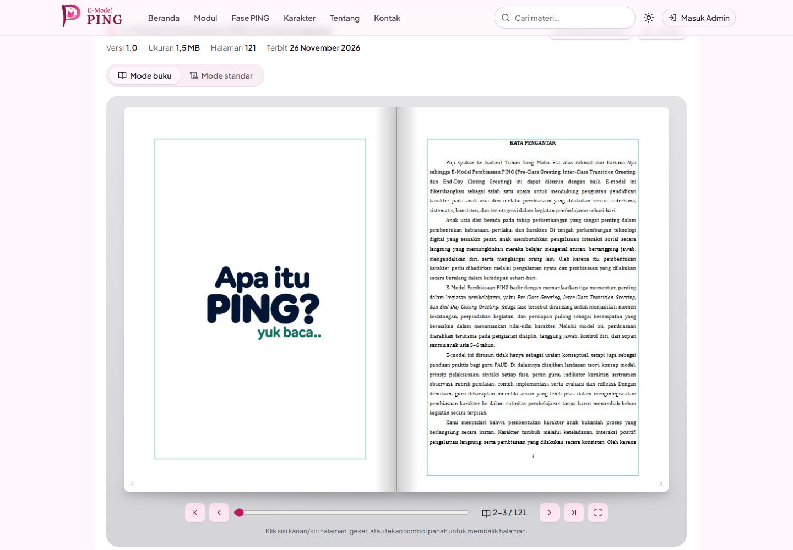
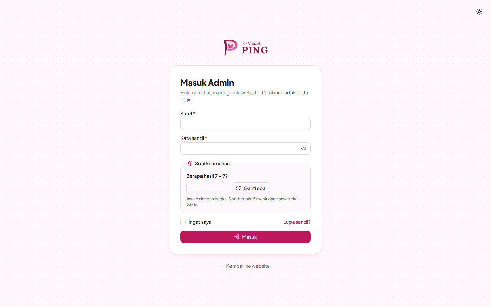
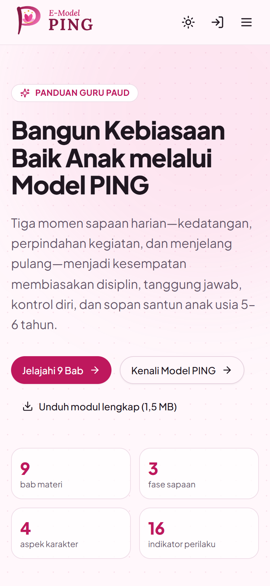
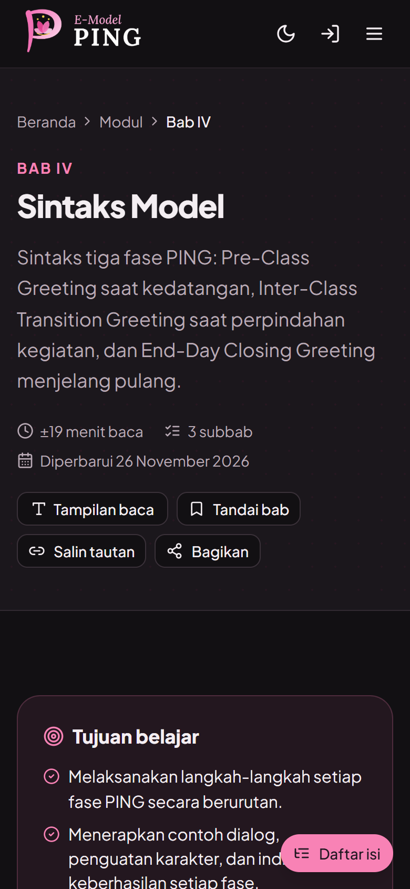

<p align="center">
  <picture>
    <source media="(prefers-color-scheme: dark)" srcset="docs/gambar/logo-gelap.png">
    
  </picture>
</p>

<h1 align="center">E-Model PING</h1>

<p align="center">
  Website e-modul publik <b>Model Pembiasaan PING</b> — <i>Pre-Class Greeting</i>, <i>Inter-Class Transition Greeting</i>, dan <i>End-Day Closing Greeting</i> —<br>
  panduan guru PAUD untuk membiasakan <b>disiplin, tanggung jawab, kontrol diri, dan sopan santun</b> anak usia 5–6 tahun.
</p>

<p align="center">
  <a href="https://github.com/yaridwan/e-modelping/actions/workflows/ci.yml"></a>
  
  
  
  
  
  
  
  
  <a href="LICENSE"></a>
</p>

<p align="center">
  <a href="#mulai-cepat">Mulai cepat</a> ·
  <a href="docs/deploy.md"><b>Panduan deploy</b></a> ·
  <a href="docs/analisis-sistem.md">Analisis sistem</a> ·
  <a href="docs/arsitektur.md">Arsitektur</a> ·
  <a href="docs/kamus-data.md">Kamus data</a> ·
  <a href="docs/pengujian.md">Pengujian</a> ·
  <a href="CHANGELOG.md">Riwayat perubahan</a>
</p>



## Sekilas

- **Materi lengkap sebagai halaman web**: 9 bab, 34 subbab, 3 fase sapaan (17 langkah), 4 aspek karakter & 16 indikator — dapat dibaca, dicari, dan dibagikan; HTML dirender di server (**Inertia SSR**) sehingga ramah SEO.
- **PDF modul dengan mode buku (flipbook)**: dua halaman berdampingan dengan animasi balik 3D, satu halaman di ponsel; tersedia juga mode standar dengan zoom, unduhan dapat dimatikan.
- **Pembaca nyaman**: daftar isi lengket, ukuran huruf & lebar baca, penanda bab, posisi baca terakhir, tema terang/gelap, tampilan ponsel.
- **Panel admin lengkap** (satu pengelola, login + captcha): editor teks kaya (Tiptap) untuk bab & subbab, versi dokumen PDF, beranda dinamis, media, galeri, FAQ, menu, pengalihan URL, **pesan masuk** (aksi massal, arsip, balas lewat surel), statistik + ekspor CSV, log audit, pengaturan identitas/logo/SEO.
- **Privasi & keamanan**: tanpa pelacak pihak ketiga, statistik pihak pertama berbasis sidik HMAC (IP mentah tidak disimpan), CSP bernonce, sanitasi HTML, validasi PDF/gambar berbasis isi, rate limit, audit log.
- **Database berbahasa Indonesia**: 23 tabel domain dengan nama tabel & kolom Indonesia (termasuk `riwayat_migrasi`), MySQL 8.4.
- **Siap produksi**: skrip rilis tanpa downtime, layanan SSR systemd, cadangan harian otomatis, ekspor/impor data lokal → server, 59 tes otomatis + CI GitHub Actions.

## Tangkapan layar

| Beranda (tema gelap)                                 | Halaman bab                                    |
| ---------------------------------------------------- | ---------------------------------------------- |
|  |  |
| **Mode buku (flipbook) PDF**                         | **Login admin (captcha)**                      |
|             |     |

<p align="center">
  
  &nbsp;&nbsp;
  
</p>

## Mulai cepat

Prasyarat: **PHP ≥ 8.4.1**, Composer 2, **MySQL 8.4**, **Node.js ≥ 22**. Detail di [§10](#10-persyaratan) dan [§11](#11-instalasi-lokal).

```bash
git clone https://github.com/yaridwan/e-modelping.git e-model-ping && cd e-model-ping
composer install && npm ci
cp .env.example .env && php artisan key:generate
# buat database MySQL lalu isi DB_* di .env (lihat §11)
php artisan migrate --seed                    # struktur + data dasar (9 bab, PDF, pengaturan, admin)
php artisan db:seed --class=DataDemoSeeder    # opsional: statistik & pesan contoh (lokal saja)
npm run build:ssr
php artisan inertia:start-ssr                 # terminal 1 — server SSR
php artisan serve                             # terminal 2 — http://127.0.0.1:8000
```

Admin: http://127.0.0.1:8000/admin/masuk — surel `admin@emodelping.test`, sandi dari `ADMIN_AWAL_SANDI` di `.env` (bila kosong, sandi acak dicetak sekali saat seeding). Pengguna Windows/XAMPP: lihat [§11](#11-instalasi-lokal) (`scripts\serve-lokal.cmd`).

## Deploy ke server

Butuh **VPS** (PHP 8.4 + MySQL 8.4 + Node 22 + Nginx) — shared hosting tidak didukung karena SSR memerlukan proses Node. Ikuti **[docs/deploy.md](docs/deploy.md)**: persiapan server, `.env` produksi, rilis tanpa downtime (`deploy/deploy.sh`), HTTPS, layanan SSR, cron & cadangan, pemindahan data lokal, verifikasi, rollback, dan pemecahan masalah. Ringkasan & daftar periksa: [§15](#15-deploy-vps-nginx--php-fpm--mysql--node-ssr--https).

## Daftar isi

1. [Tentang aplikasi](#1-tentang-aplikasi) · 2. [Teknologi](#2-teknologi-versi-terpasang--teruji) · 3. [Peran & fitur](#3-peran--fitur) · 4. [Materi PING](#4-materi-ping) · 5. [Arsitektur](#5-arsitektur-rute-alur-erd) · 6. [Database](#6-database-berbahasa-indonesia) · 7. [Matriks tabel](#7-matriks-tabel--migration--model--seeder)
2. [Desain & aksesibilitas](#8-desain-tema-aksesibilitas-animasi) · 9. [Walkthrough](#9-walkthrough-dilakukan-pada-aplikasi-lokal) · 10. [Persyaratan](#10-persyaratan) · 11. [Instalasi lokal](#11-instalasi-lokal) · 12. [Akun admin](#12-akun-admin) · 13. [Seeding](#13-seeding) · 14. [Pengujian](#14-pengujian-lint-tipe-build)
3. [Deploy VPS](#15-deploy-vps-nginx--php-fpm--mysql--node-ssr--https) ([data lokal](#15a-memindahkan-data-lokal-ke-server), [daftar periksa](#15b-daftar-periksa-sebelum-online)) · 16. [Berkas & unggahan](#16-berkas-unggahan-dokumen) · 17. [Surel](#17-surel--reset-sandi) · 18. [SEO](#18-seo) · 19. [Statistik & privasi](#19-statistik--privasi)
4. [Backup & rollback](#20-backup-restore-rollback) · 21. [Troubleshooting](#21-troubleshooting) · 22. [Status & lisensi](#22-status-pengujian-keterbatasan-lisensi) · 23. [Struktur proyek](#23-struktur-proyek) · 24. [Kontribusi & keamanan](#24-kontribusi-keamanan-kredit)

---

## 1. Tentang aplikasi

- **Masalah:** materi PING tersedia sebagai PDF 121 halaman yang sulit dibaca di ponsel, tidak dapat dicari, dan tidak terindeks mesin pencari.
- **Solusi:** setiap bab disajikan sebagai halaman HTML (SSR) yang dapat dibaca, dicari, dan dibagikan; PDF menjadi dokumen pendamping per bab dan modul lengkap.
- **Sasaran:** guru PAUD dan masyarakat (tanpa akun); satu pemilik/admin yang mengelola seluruh konten dan identitas.
- **Batas sistem:** tidak ada registrasi publik, akun guru, data/foto/skor anak, kelas berbayar, multi-tenant, atau pelacak pihak ketiga. Instrumen observasi adalah **materi**, bukan fitur penilaian. Statistik kunjungan **bukan** bukti peningkatan karakter anak atau efektivitas penelitian.

## 2. Teknologi (versi terpasang & teruji)

| Komponen                                                       | Versi                                                                                                                                      |
| -------------------------------------------------------------- | ------------------------------------------------------------------------------------------------------------------------------------------ |
| PHP                                                            | 8.5.10 (minimum **8.4.1** — Laravel 13 sendiri ^8.3, tetapi komponen Symfony 8 yang terkunci di `composer.lock` mensyaratkan ≥ 8.4.1)      |
| Laravel                                                        | **13.44.1** (rilis terbaru saat pengerjaan; proyek dibuat baru dari _React starter kit_ resmi, sehingga tidak ada upgrade dari versi lama) |
| inertiajs/inertia-laravel · @inertiajs/react · @inertiajs/vite | 3.8.0 · 3.11.0 · 3.11.0                                                                                                                    |
| React · TypeScript                                             | 19.3.1 · 5.9.3                                                                                                                             |
| Vite (Vite+ toolchain bawaan starter kit)                      | vite-plus 1.8.0 (core 8.3.8001)                                                                                                            |
| Tailwind CSS · shadcn/ui (Radix)                               | 4.3.5 · gaya _new-york_                                                                                                                    |
| Recharts (shadcn Charts) · Motion · Anime.js                   | 3.11.1 · 12.43.0 · 4.5.0                                                                                                                   |
| PDF.js (pdfjs-dist) · Tiptap                                   | 6.5.438 · 3.35.0                                                                                                                           |
| Lucide                                                         | 0.475.0                                                                                                                                    |
| symfony/html-sanitizer · smalot/pdfparser                      | 8.1.12 · 2.13.1                                                                                                                            |
| MySQL                                                          | **8.4.13** (InnoDB, utf8mb4)                                                                                                               |
| Node.js · npm                                                  | 24.13.1 (minimum **22** — syarat SSR Inertia 3) · 11.8.0                                                                                   |
| PHPUnit · Pint                                                 | 12.5.45 · 1.32.3                                                                                                                           |

**Alasan arsitektur:** monolit Laravel–Inertia memusatkan autentikasi, otorisasi, validasi, routing, dan query di backend; React hanya merender. **Inertia SSR** membuat judul, isi bab, metadata, dan tautan hadir di HTML respons awal (SEO & pembaca tanpa JS). Fortify, Passkeys, 2FA, dan Wayfinder dari starter kit dihapus karena autentikasi admin memakai kolom Indonesia + captcha (lihat [arsitektur](docs/arsitektur.md)).

## 3. Peran & fitur

| Fitur                                                                                                                                                                              | Publik | Admin |
| ---------------------------------------------------------------------------------------------------------------------------------------------------------------------------------- | ------ | ----- |
| Landing page dinamis, 9 bab, 3 fase, 4 aspek/16 indikator, FAQ, galeri, tentang & profil penyusun                                                                                  | ✔      | ✔     |
| Pembaca bab: breadcrumb, tujuan belajar, daftar isi lengket/drawer, ukuran huruf & lebar baca, penanda & posisi terakhir (localStorage), salin/bagikan tautan, navigasi bab terbit | ✔      | ✔     |
| Panel PDF (PDF.js malas, Range 206), buka di tab baru, unduh bila diizinkan                                                                                                        | ✔      | ✔     |
| Mode buku/flipbook di `/dokumen/{id}/baca`: dua halaman berdampingan (satu di ponsel), animasi balik 3D, klik/geser/panah/slider, layar penuh; pilihan mode buku/standar diingat   | ✔      | ✔     |
| Pencarian HTML terbit (`noindex,follow`) · formulir kontak (honeypot, rate limit, persetujuan)                                                                                     | ✔      | ✔     |
| Tombol **Masuk Admin** di header (ikon di ponsel, tombol di drawer menu, tautan di footer); berubah menjadi **Dashboard** bila admin sudah masuk                                   | ✔      | ✔     |
| Dashboard (widget, grafik, inventaris seluruh tabel, kesehatan)                                                                                                                    |        | ✔     |
| Bab & subbab (editor Tiptap, SEO, pratinjau, draf/terbit/arsip, urutan, riwayat)                                                                                                   |        | ✔     |
| Dokumen PDF (unggah draf privat, pratinjau, aktivasi versi, izin unduh, arsip)                                                                                                     |        | ✔     |
| Fase & langkah · aspek & indikator · beranda dinamis · halaman informasi                                                                                                           |        | ✔     |
| Pustaka media (penggunaan sebelum hapus) · galeri (izin publikasi) · FAQ · referensi                                                                                               |        | ✔     |
| Menu navigasi & tautan sosial · pengalihan URL · pesan masuk (+CSV) · statistik (+CSV) · log audit (baca saja)                                                                     |        | ✔     |
| Pengaturan (identitas, kontak, tampilan, SEO, dokumen, privasi & statistik) · profil · keamanan                                                                                    |        | ✔     |

## 4. Materi PING

**Sembilan bab:** I Pendahuluan · II Landasan Teori · III Konsep Model Pembiasaan PING · IV Sintaks Model · V Peran Guru · VI Indikator Karakter · VII Instrumen Implementasi · VIII Contoh Implementasi · IX Evaluasi Implementasi.

| Fase                            | Fungsi                                       | Durasi               | Langkah                                                                                                           |
| ------------------------------- | -------------------------------------------- | -------------------- | ----------------------------------------------------------------------------------------------------------------- |
| Pre-Class Greeting              | Rasa aman & kesiapan belajar saat kedatangan | 10–15 menit          | Penyambutan · respons salam · pengamatan kesiapan · rutinitas disiplin · penguatan · transisi ke pembelajaran (6) |
| Inter-Class Transition Greeting | Perpindahan kegiatan tertib & bermakna       | 2–5 menit, 3–6×/hari | Isyarat · penyelesaian/perapian · salam transisi · penguatan · perpindahan · kesiapan kegiatan berikutnya (6)     |
| End-Day Closing Greeting        | Refleksi, penguatan, pulang santun           | 10–15 menit          | Refleksi · apresiasi · penguatan nilai · salam penutup · pembiasaan pulang (5)                                    |

**16 indikator** (4 per aspek) — Disiplin: aturan kelas, memulai setelah instruksi, berpindah tertib, mengikuti rangkaian hingga selesai · Tanggung jawab: menyelesaikan tugas, tugas sederhana mandiri, menjaga barang, merapikan perlengkapan · Kontrol diri: berhenti saat isyarat, menunggu giliran, mengelola respons emosional, mempertahankan perhatian · Sopan santun: salam datang/pulang, menyapa & menghargai, terima kasih & maaf, bahasa santun. Skala BB=1, MB=2, BSH=3, BSB=4; total 16–64; persentase = skor/64 × 100%. **Perilaku tanpa kesempatan pengamatan tidak otomatis diberi BB.**

**Sumber:** `E-Model PING_Revisi 1.pdf` (121 halaman, penyusun Tita Sapriyanti). Teks diekstrak dengan `pdftotext` lalu dikurasi (`scripts/sumber/`); provenance halaman disimpan di `metadata_sumber`. Catatan editorial (tidak diperbaiki dengan menebak): sitasi Lickona (2022)/Bredekamp (2019) berbeda tahun dengan daftar pustaka (1992/2017); daftar tabel menyebut "Tabel 9.3 Refleksi Implementasi" sedangkan isi memakai 9.4; kolom tabel aktivitas anak fase II berjudul "Aktivitas Guru"; halaman cetak 95 memuat teks tumpang tindih (tabel alur skenario disusun ulang & ditandai). Tabel yang belum dikurasi ke HTML (2.1, 3.1–3.3, 5.1–5.4, 8.1–8.2, 9.1–9.4) ditampilkan sebagai rujukan ke halaman PDF. Foto anak di PDF **tidak** diekstrak ke galeri.

## 5. Arsitektur, rute, alur, ERD

Ringkasan di [docs/arsitektur.md](docs/arsitektur.md); diagram alur pembaca, admin+captcha, publikasi PDF, dan ERD (Mermaid) di [docs/analisis-sistem.md](docs/analisis-sistem.md).

Rute publik: `/`, `/tentang`, `/modul`, `/modul/{slug}`, `/fase/{slug}`, `/karakter`, `/panduan-penggunaan`, `/galeri`, `/pertanyaan-umum`, `/kontak`, `/kebijakan-privasi`, `/cari?q=`, `/dokumen/{versi}/baca|berkas|unduh`, `/media/{uuid}.{ext}`, `/sitemap.xml`, `/robots.txt`, `/{slug}`. Admin: `/admin/masuk`, `/admin/lupa-sandi`, `/admin/atur-ulang-sandi/{token}`, `/admin/*` (lihat `php artisan route:list`; 122 rute).

## 6. Database berbahasa Indonesia

23 tabel domain + `riwayat_migrasi` — detail tipe/validasi/indeks di [docs/kamus-data.md](docs/kamus-data.md). Pemetaan kontrak Laravel: tabel `pengguna`, kolom `surel`/`kata_sandi`/`token_pengingat`, timestamp `dibuat_pada`/`diperbarui_pada`, reset sandi kustom (`token_atur_ulang_sandi`, hash HMAC, sekali pakai), dan **`App\Support\Database\RepositoriMigrasi`** yang memetakan `migration`/`batch` ke `nama_migrasi`/`kelompok` (diuji: `migrate`, `migrate:status`, `migrate:rollback`, `migrate:fresh`). Sesi & cache memakai berkas, antrean `sync` — tidak ada tabel `sessions/cache/jobs/users`.

## 7. Matriks tabel × migration × model × seeder

| Tabel                  | Migration  | Model               | Seeder                                  | Data dasar                          | Demo                            |
| ---------------------- | ---------- | ------------------- | --------------------------------------- | ----------------------------------- | ------------------------------- |
| pengguna               | 000001     | Pengguna            | PenggunaSeeder                          | 1 admin (bootstrap aman)            | —                               |
| berkas_media           | 000002     | BerkasMedia         | BerkasMediaSeeder (+VersiDokumenSeeder) | 10 PDF sumber                       | —                               |
| token_atur_ulang_sandi | 000003     | TokenAturUlangSandi | TokenAturUlangSandiSeeder               | kosong-sengaja (token hanya di tes) | —                               |
| pengaturan_website     | 000004     | PengaturanWebsite   | PengaturanWebsiteSeeder                 | 1 (singleton)                       | —                               |
| bab_modul              | 000005     | BabModul            | BabModulSeeder                          | 9 terbit                            | —                               |
| subbab_modul           | 000006     | SubbabModul         | SubbabModulSeeder                       | 34 terbit (dari PDF)                | —                               |
| halaman_informasi      | 000007     | HalamanInformasi    | HalamanInformasiSeeder                  | 7 (6 inti)                          | —                               |
| menu_navigasi          | 000008     | MenuNavigasi        | MenuNavigasiSeeder                      | 6 utama + 5 footer                  | —                               |
| bagian_beranda         | 000009     | BagianBeranda       | BagianBerandaSeeder                     | 10 bagian                           | —                               |
| versi_dokumen          | 000010     | VersiDokumen        | VersiDokumenSeeder                      | 10 versi 1.0 aktif                  | —                               |
| fase_ping              | 000011     | FasePing            | FasePingSeeder                          | 3                                   | —                               |
| langkah_fase           | 000012     | LangkahFase         | LangkahFaseSeeder                       | 17 (6+6+5)                          | —                               |
| aspek_karakter         | 000013     | AspekKarakter       | AspekKarakterSeeder                     | 4                                   | —                               |
| indikator_karakter     | 000014     | IndikatorKarakter   | IndikatorKarakterSeeder                 | 16                                  | —                               |
| referensi_pustaka      | 000015     | ReferensiPustaka    | ReferensiPustakaSeeder                  | 16 (sesuai sumber)                  | —                               |
| galeri_kegiatan        | 000016     | GaleriKegiatan      | GaleriKegiatanSeeder                    | kosong-sengaja (izin publikasi)     | —                               |
| pertanyaan_umum        | 000017     | PertanyaanUmum      | PertanyaanUmumSeeder                    | 8                                   | —                               |
| tautan_sosial          | 000018     | TautanSosial        | TautanSosialSeeder                      | 3 slot nonaktif tanpa URL           | —                               |
| pesan_kontak           | 000019     | PesanKontak         | PesanKontakSeeder                       | kosong                              | 5 (`data_contoh`)               |
| kunjungan_halaman      | 000020     | KunjunganHalaman    | KunjunganHalamanSeeder                  | kosong                              | ±3.900 (90 hari, deterministik) |
| aktivitas_dokumen      | 000021     | AktivitasDokumen    | AktivitasDokumenSeeder                  | kosong                              | ±420                            |
| log_aktivitas          | 000022     | LogAktivitas        | LogAktivitasSeeder                      | 1 (seed dasar)                      | 5                               |
| pengalihan_url         | 000023     | PengalihanUrl       | PengalihanUrlSeeder                     | kosong (otomatis saat slug berubah) | 1 contoh                        |
| riwayat_migrasi        | (migrator) | —                   | RiwayatMigrasiSeeder (verifikasi saja)  | diisi migrator                      | —                               |

## 8. Desain, tema, aksesibilitas, animasi

Pink profesional (primary `#BE185D`, aksen `#EC4899`, latar `#FFF7FB`, teks `#1F1720`); mode gelap netral dengan aksen pink terang. Kontras: teks `#BE185D` di atas putih ±6:1, teks putih di atas `#BE185D` ±6:1; pink `#EC4899` hanya untuk aksen/dekorasi. Tema terang/gelap/sistem untuk publik (cookie + localStorage) dan admin (disimpan di profil); skrip inline ber-nonce mencegah kilatan tema. Aksesibilitas: tautan "Lewati ke konten utama", satu H1 per halaman, label & `aria-*` pada kontrol, fokus terlihat 3px, tombol lihat/sembunyikan sandi dapat dijangkau keyboard, tabel dapat digeser, grafik punya alternatif tabel, `prefers-reduced-motion` dihormati. **Motion**: kartu, drawer, panel, umpan balik formulir. **Anime.js**: hanya ilustrasi SVG tiga fase di beranda (dimuat dinamis, _scope_ elemen, dibersihkan saat unmount, dijeda di luar layar).

## 9. Walkthrough (dilakukan pada aplikasi lokal)

**Pembaca:** `/` tampil tanpa login (SSR, satu H1) → "Jelajahi 9 Bab" → Bab IV `/modul/sintaks-model` → daftar isi → "Tampilan baca" ukuran huruf 17→19px, muat ulang tetap 19px → "Baca PDF di sini" memuat 21 halaman via permintaan Range 206, pindah halaman → `/cari?q=kontrol diri` (29 hasil materi terbit) → kirim pesan kontak → konfirmasi "Pesan terkirim" tanpa menampilkan isi pesan. Tampilan ponsel 375 px: tanpa gulir horizontal, tombol "Daftar isi" mengambang.

**Admin:** `/admin/masuk` → isi surel, sandi, jawab soal "7 + 7" → dashboard; mode data demo menampilkan grafik shadcn/Recharts; editor Tiptap memuat subbab IV-A. Alur draf subbab, unggah/aktivasi PDF, arsip bab, perubahan slug (301), identitas/logo, profil/foto, statistik/CSV, dan arsip pesan diverifikasi oleh **tes otomatis** (lihat §14) — tidak semuanya diklik manual di browser.

## 10. Persyaratan

PHP ≥ 8.4.1 (PHP 8.2 bawaan XAMPP **tidak** cukup — gagal dengan pesan _"Composer detected issues in your platform"_) dengan ekstensi `pdo_mysql, mbstring, openssl, fileinfo, gd (JPEG/PNG/WebP), intl, zip, bcmath, ctype, dom, xml`; Composer 2; Node.js ≥ 22 + npm; MySQL 8.4 (MariaDB tidak diuji). Opsional untuk menyiapkan ulang materi dari PDF: `pdftotext` (poppler) dan Python 3 + `pypdf` (`scripts/sumber/`).

## 11. Instalasi lokal

```bash
git clone https://github.com/yaridwan/e-modelping.git e-model-ping && cd e-model-ping
composer install
cp .env.example .env
php artisan key:generate          # hanya untuk instalasi baru
```

Buat database & user ber-hak minimum (contoh MySQL):

```sql
CREATE DATABASE e_model_ping CHARACTER SET utf8mb4 COLLATE utf8mb4_unicode_ci;
CREATE USER 'e_model_ping'@'127.0.0.1' IDENTIFIED BY '<sandi-kuat>';
GRANT SELECT, INSERT, UPDATE, DELETE, CREATE, ALTER, DROP, INDEX, REFERENCES, LOCK TABLES ON e_model_ping.* TO 'e_model_ping'@'127.0.0.1';
```

Isi `DB_*` di `.env`, lalu:

```bash
php artisan migrate
php artisan db:seed                       # data dasar
php artisan db:seed --class=DataDemoSeeder  # opsional, lokal saja
npm ci
npm run build:ssr                         # build klien + SSR (bootstrap/ssr/app.js)
php artisan inertia:start-ssr             # terminal 1: server SSR 127.0.0.1:13714
php artisan serve                         # terminal 2: http://127.0.0.1:8000
```

**Windows/XAMPP (CMD):** `php` di PATH XAMPP adalah 8.2, jadi pakai skrip yang menunjuk ke `C:\xampp3\php85`:

```bat
cd /d C:\xampp3\htdocs\e-ping
scripts\serve-lokal.cmd
```

Skrip menyalakan MySQL 8.4 (port 3307) bila belum jalan, membuka server SSR di jendela terpisah, lalu menjalankan `artisan serve` di http://127.0.0.1:8000. Untuk perintah artisan lain di CMD, awali sesi dengan `set PATH=C:\xampp3\php85;%PATH%` atau panggil `C:\xampp3\php85\php.exe artisan …`. PowerShell: `scripts/serve-lokal.ps1` menjalankan SSR + `artisan serve` dengan `PHP_INI_SCAN_DIR=scripts/php-lokal` (batas unggah 30 MB). Untuk pengembangan dengan HMR: `npm run dev` (plugin Inertia juga menyediakan SSR di mode dev). `composer setup` menjalankan install → .env → key → migrate → seed → `npm ci` → `npm run build:ssr`.

## 12. Akun admin

- **Lokal:** isi `ADMIN_AWAL_SANDI` di `.env` sebelum `db:seed`; bila kosong, sandi acak 16 karakter dibuat dan **dicetak sekali** di CLI (tidak ditulis ke log) dan akun ditandai _wajib ganti sandi_. Surel bawaan `admin@emodelping.test`. Pada instalasi lokal hasil pengerjaan ini, sandi tersimpan di `.env` (`ADMIN_AWAL_SANDI`) — ganti melalui menu Keamanan.
- **Produksi:** isi `ADMIN_AWAL_SUREL` + `ADMIN_AWAL_SANDI` (≥12 karakter), jalankan `php artisan ping:admin-awal`, lalu **hapus** nilai sandi dari `.env`. Bootstrap hanya membuat akun bila belum ada akun dan **tidak pernah** mengganti sandi yang sudah ada.
- Pemulihan: `/admin/lupa-sandi` (respons generik, token HMAC 60 menit sekali pakai).

## 13. Seeding

| Perintah                                     | Isi                                                                                                                       | Aman di produksi                                                                           | Aman diulang                                                                  |
| -------------------------------------------- | ------------------------------------------------------------------------------------------------------------------------- | ------------------------------------------------------------------------------------------ | ----------------------------------------------------------------------------- |
| `php artisan db:seed`                        | data dasar (`DataDasarSeeder`)                                                                                            | ✔                                                                                          | ✔ — membuat yang belum ada; tidak menimpa suntingan, sandi, branding, dokumen |
| `php artisan db:seed --class=DataDemoSeeder` | aktivitas, pesan, log, pengalihan contoh (`data_contoh = true`)                                                           | ✘ ditolak                                                                                  | ✔ (dilewati bila sudah ada)                                                   |
| `php artisan ping:reset-demo`                | **DESTRUKTIF**: hapus semua `data_contoh` lalu buat ulang                                                                 | ✘ ditolak                                                                                  | —                                                                             |
| `php artisan ping:hapus-demo`                | hapus semua `data_contoh` **tanpa** membuat ulang (data nyata, konten, media, pengaturan tidak disentuh; tercatat di log) | ✔ — dipakai setelah memindahkan DB lokal ke server                                         | ✔                                                                             |
| `php artisan migrate:fresh --seed`           | **DESTRUKTIF**: hapus semua tabel                                                                                         | hanya DB lokal kosong/terisolasi (diblokir di produksi oleh `prohibitDestructiveCommands`) | —                                                                             |

PDF: seeder mengimpor `database/seeders/aset/sumber/*.pdf` (hasil `scripts/sumber/pisah_pdf.py`) setelah memeriksa SHA-256 & jumlah halaman pada `manifest.json`. Bila aset tidak ada/tidak cocok, dibuat PDF valid berlabel **"Dokumen demonstrasi — ringkasan untuk pengujian aplikasi"**.

## 14. Pengujian, lint, tipe, build

```bash
php artisan test            # PHPUnit pada MySQL (DB e_model_ping_testing, lihat phpunit.xml)
composer lint:check         # Pint
npm run check               # lint + format (Vite+/oxlint/oxfmt)
npm run types:check         # tsc --noEmit
npm run build:ssr && php artisan inertia:start-ssr && php artisan inertia:check-ssr
```

Hasil aktual ada di [docs/pengujian.md](docs/pengujian.md).

## 15. Deploy VPS (Nginx + PHP-FPM + MySQL + Node SSR + HTTPS)

Berkas contoh: `deploy/nginx/e-model-ping.conf`, `deploy/systemd/e-model-ping-ssr.service` (atau `deploy/supervisor/e-model-ping-ssr.conf`), `deploy/cron/e-model-ping`, `deploy/deploy.sh` (memanggil `deploy/cadangan.sh` sebelum migrasi), `deploy/cadangan.sh`, `deploy/impor-data.sh`.

1. Server: PHP-FPM 8.4/8.5 + ekstensi §10, MySQL 8.4, Node 22+, Nginx, Certbot. Buat DB & user ber-hak minimum; simpan sandi hanya di `.env` server.
2. `.env` produksi: `APP_ENV=production`, `APP_DEBUG=false`, `APP_URL=https://domain-anda`, `SESSION_SECURE_COOKIE=true`, `MAIL_*` SMTP nyata.
3. Rilis: `composer install --no-dev --optimize-autoloader` → `npm ci && npm run build:ssr` (node_modules tetap ada karena dipakai SSR) → **backup DB** → `php artisan migrate --force` → `php artisan db:seed --force` (data dasar) → `php artisan config:cache route:cache view:cache` → restart PHP-FPM & layanan SSR → `php artisan inertia:check-ssr`.
4. Document root hanya `public/`. Writable hanya `storage/` dan `bootstrap/cache/` (pemilik `www-data`, `775/664`, tanpa 777).
5. Cron: `* * * * * php artisan schedule:run` (retensi harian). Antrean `sync` → **tidak** perlu queue worker.
6. **Jangan** menjalankan `migrate:fresh`, `ping:reset-demo`, `DataDemoSeeder`, atau mengganti `APP_KEY` pada instalasi lama (memutus token & sidik).
7. Hosting tanpa proses Node persisten **tidak** mendukung SSR produksi ini; `npm run build` saja tidak menghasilkan HTML server (metadata Blade tetap ada, tetapi isi halaman dirender klien).
8. Jangan mengunggah `public/hot` (sisa `npm run dev`): bila ada, halaman memuat aset dari server Vite yang tidak berjalan. `.env` lokal, `vendor/`, `node_modules/`, `cadangan/` juga tidak ikut diunggah.

### 15a. Memindahkan data lokal ke server

Konten yang sudah Anda ubah di komputer lokal (logo, sampul, galeri, pengaturan, suntingan bab, pesan) tersimpan di database lokal **dan** di `storage/app/private/media`. Pindahkan keduanya sekaligus:

1. **Di komputer lokal** (MySQL lokal harus berjalan):
    ```powershell
    powershell -ExecutionPolicy Bypass -File scripts\ekspor-data-lokal.ps1
    ```
    Hasil: `cadangan\e-model-ping-data-YYYYMMDD-HHMMSS.tar.gz` (database + media). **Berisi data pribadi** — jangan dibagikan.
2. **Unggah ke server**, mis. `scp cadangan\e-model-ping-data-….tar.gz pengguna@server:/tmp/` lalu `chmod 640` dan `chgrp www-data` arsip itu.
3. **Di server** (setelah rilis pertama `deploy.sh` berhasil dan `.env` produksi terisi):
    ```bash
    sudo install -d -o www-data -g www-data -m 700 /var/www/e-model-ping/cadangan
    sudo -u www-data bash /var/www/e-model-ping/current/deploy/impor-data.sh /tmp/e-model-ping-data-….tar.gz
    ```
    Skrip mencadangkan data server lebih dulu, memasang mode pemeliharaan, **mengganti** isi database server, menyalin media, menjalankan migrasi baru, menghapus data demo (`ping:hapus-demo`; lewati dengan `--pertahankan-demo`), membangun ulang cache, lalu menyalakan website. Bila gagal, website tetap dalam mode pemeliharaan dan cadangan ada di `/var/www/e-model-ping/cadangan`.
4. Login admin, periksa beranda/logo/PDF, lalu **hapus arsip** di server dan di komputer lokal.

Catatan: `APP_KEY` server boleh berbeda dari lokal untuk pemindahan pertama (akibatnya hanya sesi/token reset lama tidak berlaku dan sidik statistik dimulai baru). Setelah online, **jangan** mengganti `APP_KEY` lagi.

### 15b. Daftar periksa sebelum online

- [ ] VPS dengan PHP 8.4.1+ (FPM), MySQL 8.4, Node 22+, Nginx, Certbot; domain mengarah ke server.
- [ ] `.env` produksi: `APP_ENV=production`, `APP_DEBUG=false`, `APP_URL=https://domain-anda`, `SESSION_SECURE_COOKIE=true`, `APP_KEY` baru (`php artisan key:generate`), kredensial DB server.
- [ ] SMTP nyata di `MAIL_*` dan `MAIL_FROM_ADDRESS` dari domain Anda; uji "Lupa sandi".
- [ ] Surel akun admin diganti ke alamat asli (Profil Saya) — alamat `.test` tidak dapat menerima surel.
- [ ] Data lokal dipindahkan (15a) **atau** konten diisi ulang di server; data demo sudah terhapus.
- [ ] Konten uji dibersihkan (mis. galeri percobaan), kontak publik diisi bila perlu.
- [ ] Layanan SSR aktif (`php artisan inertia:check-ssr`), cron `schedule:run` + cadangan harian terpasang, folder `cadangan` ada.
- [ ] Cadangan disalin berkala ke luar server; uji pemulihan sekali.

## 16. Berkas, unggahan, dokumen

Semua unggahan disimpan di `storage/app/private/media/{gambar|pdf}/…` dengan nama UUID buatan aplikasi (nama asli hanya metadata, traversal dicegah). Tidak memakai `storage:link` untuk PDF/gambar; gambar publik dilayani `/media/{uuid}.{ext}` hanya bila dirujuk konten terbit/identitas. Validasi PDF: ukuran (batas pengaturan ≤ `PING_BATAS_UNGGAH_MAKS_MB`, bawaan 25), MIME server `application/pdf`, signature `%PDF-`, `%%EOF`, tanpa `/Encrypt`, tanpa JavaScript/Launch/EmbeddedFile, keterbacaan parser, ≤500 halaman. Gambar: JPG/PNG/WebP diproses ulang GD (metadata dibuang, sisi ≤4000 px); SVG unggahan ditolak. **Validasi ini bukan pemindai malware** — tidak ada antivirus terpasang; tambahkan ClamAV bila diperlukan. Batas PHP/Nginx: `upload_max_filesize=30M`, `post_max_size=32M`, `client_max_body_size 30M`. Versi dokumen: satu aktif per lingkup; versi lama diarsipkan (berkas tetap untuk admin); draf yang belum pernah terbit dapat dihapus. Header PDF: `Content-Type`, `nosniff`, `X-Robots-Tag: noindex`, `Cache-Control: private, no-cache` (publik) / `no-store` (pratinjau), dukungan Range/206. Menonaktifkan unduhan menutup tombol dan endpoint, **bukan DRM**.

## 17. Surel & reset sandi

Lokal: `MAIL_MAILER=log` (surel ditulis ke `storage/logs/laravel.log`). Tes memakai `Notification::fake()`. Produksi: isi SMTP di `.env`; **SMTP produksi belum dikonfigurasi/diuji dalam pengerjaan ini**. Tautan reset dibangun dari `APP_URL`, bukan header Host.

## 18. SEO

SSR HTML; `lang="id"`; satu H1; judul dari templat pengaturan; canonical absolut dari `APP_URL` (header Host palsu diabaikan, diuji); OG & Twitter Card; JSON-LD `WebSite`+`SearchAction`, `Person`/`Organization` sesuai pengaturan, `BreadcrumbList`, `LearningResource` per bab/fase, `FAQPage` hanya untuk FAQ yang tampil. `sitemap.xml` hanya URL kanonis terbit (lastmod dari perubahan bab/subbab), tanpa admin/pencarian/dokumen/token. `noindex` untuk admin, login, pencarian, halaman penampil PDF, dan berkas PDF (`X-Robots-Tag`). Perubahan slug → 301. Halaman tidak ada → 404 sungguhan. `robots.txt` dinamis (produksi: `Disallow: /admin`; non-produksi: `Disallow: /`) — bukan pengganti autentikasi. Lighthouse belum dijalankan (lihat keterbatasan).

## 19. Statistik & privasi

Kunjungan = respons 200 halaman publik, satu per sidik/jalur/hari (partial reload, prefetch, bot, admin masuk dikecualikan sesuai pengaturan). Sidik = HMAC(APP_KEY, IP terpotong + user agent) — IP mentah tidak disimpan; "pengunjung unik" adalah perkiraan. Baca/unduh PDF = respons yang dilayani server, satu per sidik/versi/jenis/hari; Range lanjutan tidak dihitung. Data demo (`data_contoh`) tidak pernah dicampur dengan data nyata dan berlabel di UI. Retensi: `ping:bersihkan-retensi` (terjadwal 02:30 WIB). Tidak ada Google Analytics/pelacak eksternal; font disajikan lokal.

## 20. Backup, restore, rollback

- **Backup harian:** `deploy/cadangan.sh` (dipasang lewat `deploy/cron/e-model-ping`, pukul 01:30) membuat `db-*.sql.gz` + `media-*.tar.gz` di `/var/www/e-model-ping/cadangan` dan menyimpan 14 hari (`SIMPAN_HARI`). Kredensial dibaca dari `.env` lewat berkas opsi sementara (tidak tampil di daftar proses). Simpan juga salinan aman `.env` (berisi `APP_KEY`) dan **salin cadangan ke luar server** secara berkala.
- **Restore:** pulihkan DB dan folder `storage/app/private` dari titik waktu yang sama, gunakan `APP_KEY` yang sama, lalu `php artisan ping:periksa-berkas` (melaporkan berkas hilang/yatim) dan `php artisan optimize:clear`.
- **Rollback rilis:** arahkan symlink `current` ke rilis sebelumnya + restart PHP-FPM & SSR; rollback migrasi hanya bila migrasi rilis tersebut reversibel dan setelah backup.
- **Berkala:** `composer audit`, `npm audit`, pembaruan keamanan OS/PHP/Node, cek log `storage/logs`, uji restore.

## 21. Troubleshooting

| Gejala                                                   | Penyebab & solusi                                                                                                                        |
| -------------------------------------------------------- | ---------------------------------------------------------------------------------------------------------------------------------------- |
| `Composer detected issues in your platform … ">= 8.4.1"` | `php` yang terpanggil terlalu lama (mis. PHP 8.2 XAMPP). Pakai `scripts\serve-lokal.cmd` atau `C:\xampp3\php85\php.exe artisan …`.       |
| `SQLSTATE[HY000] [2002]`                                 | MySQL tidak berjalan/port salah (`DB_PORT`). Lokal: `C:\mysql84\bin\mysqld.exe --defaults-file=C:\mysql84\my-ping.ini`.                  |
| `Table 'riwayat_migrasi' doesn't exist` saat seeding     | Jalankan `php artisan migrate` dahulu.                                                                                                   |
| Unggah gagal / 413                                       | Naikkan `upload_max_filesize`, `post_max_size` (PHP) & `client_max_body_size` (Nginx); lokal pakai `PHP_INI_SCAN_DIR=scripts/php-lokal`. |
| PDF "tidak dapat dibaca parser"                          | Berkas rusak/terenkripsi; simpan ulang sebagai PDF standar tanpa sandi.                                                                  |
| `Vite manifest not found`                                | Jalankan `npm run build` / `npm run build:ssr`.                                                                                          |
| HTML tanpa isi (body kosong)                             | Server SSR mati: `php artisan inertia:check-ssr`, `inertia:start-ssr`; lihat log layanan.                                                |
| Kilatan tema / hydration warning                         | Pastikan cookie `appearance` tidak dienkripsi (sudah dikecualikan di `bootstrap/app.php`).                                               |
| Surel reset tidak sampai                                 | Lokal: cek `storage/logs/laravel.log`; produksi: konfigurasi SMTP.                                                                       |
| Permission denied                                        | `chown -R www-data:www-data storage bootstrap/cache` dan `chmod -R ug+rwX` (tanpa 777).                                                  |
| Composer timeout di jaringan lambat                      | Ulangi `composer install`; `COMPOSER_MAX_PARALLEL_HTTP=2`; bila hanya autoload tertunda: `composer dump-autoload` (offline).             |

## 22. Status pengujian, keterbatasan, lisensi

Status aktual: lihat [docs/pengujian.md](docs/pengujian.md). Keterbatasan utama: SMTP produksi, Lighthouse/axe, Playwright, dan deploy VPS belum dilakukan; tidak ada pemindai malware; pencarian tidak mencakup isi PDF; sebagian tabel sumber dirujuk ke PDF; galeri kosong sampai pemilik mengunggah media berizin; kontak/akun sosial/foto penyusun tidak diisi karena tidak tersedia dari sumber.

**Lisensi:** kode aplikasi MIT (lihat [`LICENSE`](LICENSE)). **Hak cipta materi** E-Model Pembiasaan PING (teks dan PDF di `database/seeders/aset/sumber`) tetap milik penyusun dan tidak termasuk lisensi kode. Aset bawaan (logo lencana "P", ilustrasi SVG tiga fase, gambar Open Graph) dibuat untuk proyek ini. Font Plus Jakarta Sans (SIL Open Font License) disajikan lokal. Komponen shadcn/ui (MIT), Lucide (ISC).

## 23. Struktur proyek

```text
app/
├── Console/Commands/      # ping:admin-awal, ping:hapus-demo, ping:reset-demo, ping:bersihkan-retensi, ping:periksa-berkas, ping:aktifkan-dokumen
├── Enums/                 # status konten & pesan
├── Http/
│   ├── Controllers/       # Publik/, Admin/, Auth/
│   ├── Middleware/        # HeaderKeamanan (CSP nonce), HandleInertiaRequests, pencatat kunjungan
│   ├── Requests/          # validasi formulir (FormRequest)
│   └── Resources/         # bentuk data untuk halaman publik
├── Layanan/               # logika domain: dokumen PDF, media, statistik, SEO, audit, sanitasi HTML, pengaturan
├── Models/                # 23 model berbahasa Indonesia
└── Support/               # RepositoriMigrasi (riwayat_migrasi), ekspor CSV, skema beranda
database/
├── migrations/            # 23 migrasi (000001–000023)
└── seeders/               # DataDasarSeeder, DataDemoSeeder, aset/sumber/*.pdf, data/ (materi kurasi)
resources/
├── css/app.css            # token warna, tema terang/gelap, gaya materi
├── js/
│   ├── pages/             # publik/, admin/, auth/ (halaman Inertia)
│   ├── components/        # publik/ (penampil PDF, flipbook, header…), admin/, umum/, ui/ (shadcn)
│   ├── layouts/           # publik, admin, auth
│   └── app.tsx            # entri klien + SSR
└── views/app.blade.php    # kerangka HTML, meta SEO, JSON-LD
routes/web.php · routes/console.php
tests/Feature, tests/Unit  # 59 tes PHPUnit (MySQL)
deploy/                    # deploy.sh, cadangan.sh, impor-data.sh, nginx/, systemd/, supervisor/, cron/, php/
scripts/                   # serve-lokal (Windows), ekspor-data-lokal.ps1, sumber/ (ekstraksi materi PDF)
docs/                      # deploy, analisis sistem, arsitektur, kamus data, pengujian, gambar/
.github/                   # CI GitHub Actions, templat issue & pull request
```

## 24. Kontribusi, keamanan, kredit

- **Kontribusi:** baca [CONTRIBUTING.md](CONTRIBUTING.md) — standar kode, perintah pemeriksaan, konvensi penamaan Indonesia.
- **Keamanan:** laporkan celah secara privat sesuai [SECURITY.md](SECURITY.md) (jangan lewat issue publik).
- **Riwayat perubahan:** [CHANGELOG.md](CHANGELOG.md).
- **Penyusun materi:** Tita Sapriyanti — _E-Model Pembiasaan PING_ (Revisi 1, 121 halaman).
- **Pengembang website:** [Ridwan (@yaridwan)](https://github.com/yaridwan).
