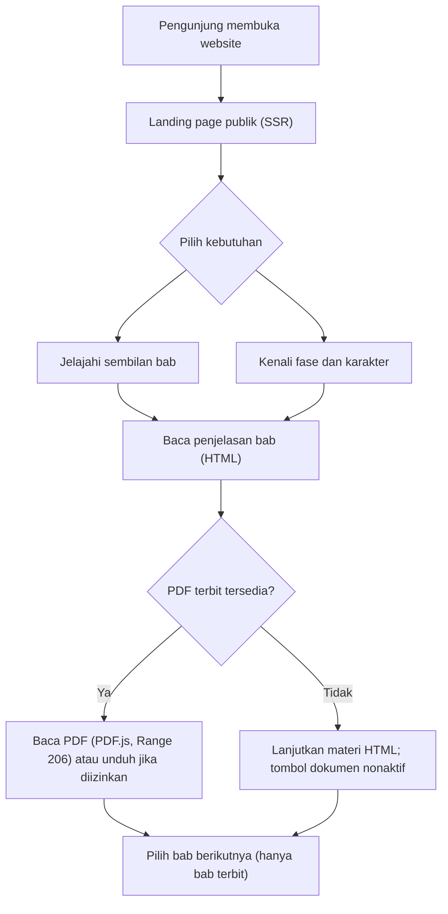
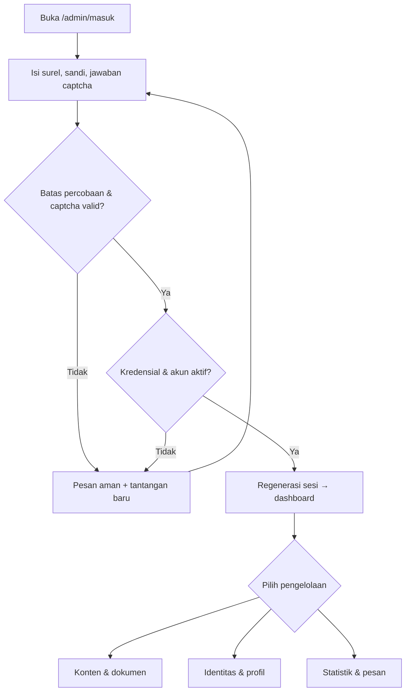
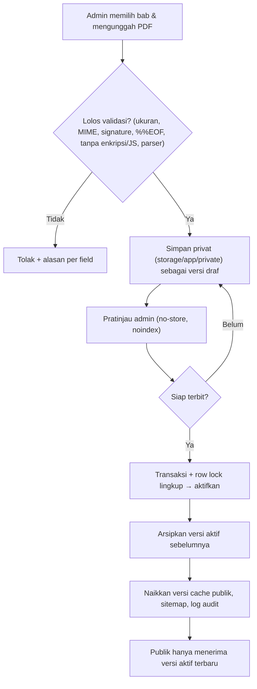
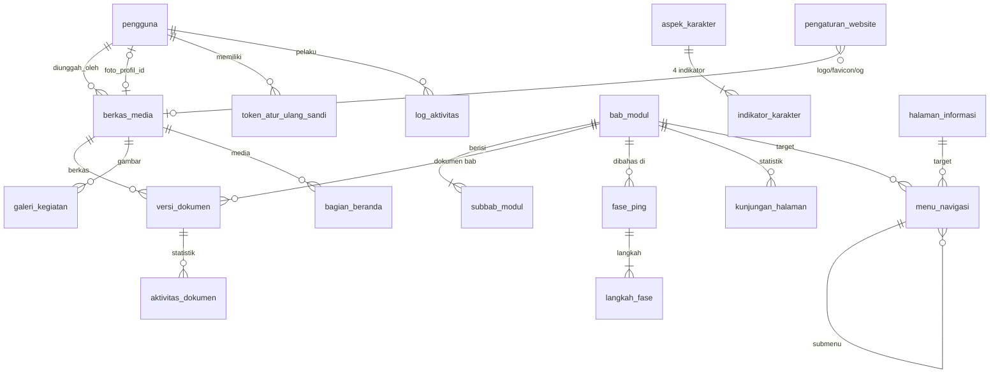

# Analisis Sistem — E-Model PING

## Masalah yang dilayani

Guru PAUD membutuhkan panduan praktis untuk membiasakan disiplin, tanggung jawab, kontrol diri, dan sopan santun anak usia 5–6 tahun pada momen harian (kedatangan, perpindahan kegiatan, kepulangan). Materi E-Model Pembiasaan PING tersedia sebagai PDF 121 halaman; website ini menyajikannya sebagai e-modul HTML yang dapat dibaca, dicari, dan diindeks, dengan PDF sebagai dokumen pendamping.

## Batas sistem

| Termasuk                                                                                                                  | Tidak termasuk                                          |
| ------------------------------------------------------------------------------------------------------------------------- | ------------------------------------------------------- |
| Landing page publik, 9 bab + subbab HTML, 3 fase, 4 aspek & 16 indikator (referensi), FAQ, galeri, kontak, pencarian HTML | Registrasi publik, akun guru, dashboard guru, langganan |
| Satu akun pemilik/admin (CMS penuh)                                                                                       | Multi-tenant, marketplace, LMS berbayar, RBAC kompleks  |
| Statistik pihak pertama berpseudonim                                                                                      | Pelacak pihak ketiga, klaim efektivitas penelitian      |
| Instrumen observasi sebagai **materi**                                                                                    | Penyimpanan data/skor/foto anak secara daring           |

## Aktor & peran

| Kemampuan                                                                                                     | Pengunjung/guru                       | Admin                |
| ------------------------------------------------------------------------------------------------------------- | ------------------------------------- | -------------------- |
| Membaca materi terbit, PDF, mencari, mengirim pesan                                                           | ✔ (tanpa login)                       | ✔                    |
| Mengunduh PDF                                                                                                 | ✔ bila diizinkan global & per dokumen | ✔ (pratinjau privat) |
| Melihat draf/arsip, pratinjau                                                                                 | ✘                                     | ✔                    |
| Kelola bab/subbab, dokumen, fase, karakter, beranda, halaman, media, galeri, FAQ, referensi, menu, pengalihan | ✘                                     | ✔                    |
| Pesan masuk, statistik, log audit (baca saja), pengaturan, profil, keamanan                                   | ✘                                     | ✔                    |

## Peta halaman publik

`/`, `/tentang`, `/modul`, `/modul/{slug}`, `/fase/{slug}`, `/karakter`, `/panduan-penggunaan`, `/galeri`, `/pertanyaan-umum`, `/kontak` (GET/POST), `/kebijakan-privasi`, `/cari?q=`, `/dokumen/{versi}/baca` (halaman penampil), `/dokumen/{versi}/berkas` (PDF inline, Range), `/dokumen/{versi}/unduh`, `/media/{uuid}.{ext}`, `/sitemap.xml`, `/robots.txt`, `/{slug}` (halaman informasi tambahan, mis. `/pesan-untuk-guru-paud`), `/admin/masuk`, `/admin/lupa-sandi`, `/admin/atur-ulang-sandi/{token}`.

## Alur utama

### Pembaca publik

### Admin dan captcha

### Unggah dan publikasi PDF

## ERD ringkas

Tabel tanpa relasi: `pertanyaan_umum`, `tautan_sosial`, `referensi_pustaka`, `pesan_kontak`, `pengalihan_url`.

## Aturan bisnis kunci

1. Akses publik selalu memakai _scope_ terbit di server (bab, subbab, halaman, fase, galeri, versi dokumen + bab induk terbit).
2. PDF di penyimpanan privat; endpoint publik memeriksa terbit + aktif + bab induk terbit; unduh memeriksa izin global **dan** per dokumen. Menonaktifkan unduh bukan DRM.
3. Satu versi aktif per lingkup: indeks unik kolom tergenerasi + transaksi + `SELECT … FOR UPDATE`.
4. Perubahan slug → 301 dari URL lama; pengalihan diratakan (tanpa rantai) dan dicegah loop.
5. Struktur inti: 9 bab dan 3 fase tidak dapat dibuat/dihapus; bab menyisakan ≥1 subbab; fase ≥1 langkah; halaman inti tidak dapat dihapus.
6. Media yang masih dirujuk tidak dapat dihapus; gambar hanya publik bila dirujuk konteks terbit.
7. Statistik: deduplikasi harian, bot/admin dikecualikan, data demo terpisah, retensi terjadwal.
